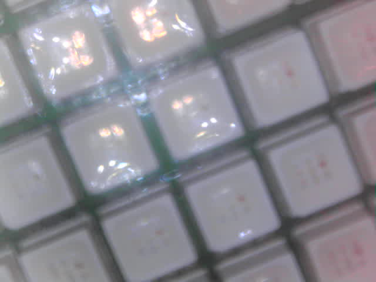
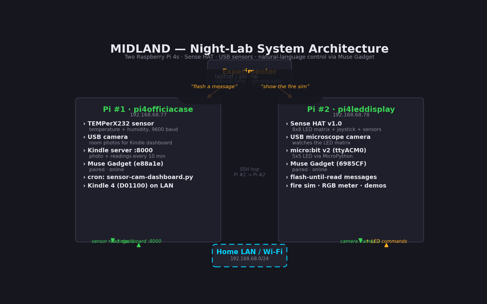

# Muselab

**One night, two Raspberry Pis, seven experiments — and not a single datasheet.**

On the night of October 17–18, 2026, this repository was built live, experiment by
experiment, driven entirely by short natural-language requests. No driver
wrangling, no dependency archaeology, no "I'll get back to this next weekend."
Each idea went from sentence to running demo in minutes.

The thesis of this repo is simple: **when an AI agent absorbs the technical
friction, the experimenter gets to spend the night on the question, the
observation, and the data — not the wiring.**

Read [PHILOSOPHY.md](PHILOSOPHY.md) for the full argument, [WORKFLOW.md](WORKFLOW.md)
for the loop we followed all night, and `experiments/` for the lab notebook.



## Hardware

| Device | Hostname | Role |
|---|---|---|
| Raspberry Pi 4 | `pi4officiacase` (192.168.68.77) | TEMPerX232 USB temperature/humidity sensor, USB webcam, Kindle dashboard server |
| Raspberry Pi 4 | `pi4leddisplay` (192.168.68.78) | Sense HAT v1.0 (8×8 RGB LED matrix, joystick, temp/humidity/pressure/IMU), USB camera (Andonstar V160), micro:bit v2 |
| micro:bit v2 | via USB serial `/dev/ttyACM0` | 5×5 LED matrix display, buttons |



## Experiments

| # | Experiment | One-line summary |
|---|---|---|
| 01 | [Message beacon](experiments/01-message-beacon.md) | LED flashes until you press the joystick — then your message appears once and the display goes dark |
| 02 | [Fire simulator](experiments/02-fire-simulator.md) | Doom-style fire algorithm on 64 pixels; heat rises, cools, and glows |
| 03 | [Counter 1–1000](experiments/03-counter.md) | Every integer from 1 to 1000, scrolled in green, one per second |
| 04 | [RGB light meter](experiments/04-rgb-light-meter.md) | Live web dashboard of camera R/G/B intensity — cover the lens, watch the traces fall |
| 05 | [Color feedback loop](experiments/05-color-feedback-loop.md) | The HAT shows red/green/blue under the camera while the dashboard watches each channel spike in turn |
| 06 | [micro:bit hello](experiments/06-microbit-hello.md) | Flash MicroPython to the micro:bit and scroll "hi Tommaso" on its 5×5 display |
| 07 | [Cross-Pi sensing](experiments/07-cross-pi-sensing.md) | Read 21.7 °C / 48.7 % on Pi #1, display it on Pi #2's Sense HAT — two Pis, one instrument |

## Repository layout

```
muselab/
├── README.md            # you are here
├── PHILOSOPHY.md        # the essay: experiment-first tinkering
├── WORKFLOW.md          # the loop: idea → sentence → running demo → observe → iterate
├── experiments/         # the lab notebook, one file per experiment
├── src/                 # the scripts, exactly as run that night
├── images/              # photos and diagrams
└── docs/                # GitHub Pages site
```

## Quickstart

Every experiment is a single self-contained Python script in `src/`. They were
written for Raspberry Pi OS (Debian 12/13) with Python 3.11+.

```bash
git clone https://github.com/marcocaggioni/muselab.git
cd muselab/src

# Example: the message beacon (needs a Sense HAT and the evdev package)
pip install --break-system-packages evdev sense-hat
echo "Hello from the lab" > ~/led-message.txt
python3 msg-flash.py     # flashes until you press the joystick
```

Each experiment doc lists its exact dependencies and the one-liner that ran it.

## The site

A browsable version of this notebook — with the workflow diagram as an
interactive canvas — is published via GitHub Pages from `docs/`.

## License

Experiments are MIT. The philosophy is free.
