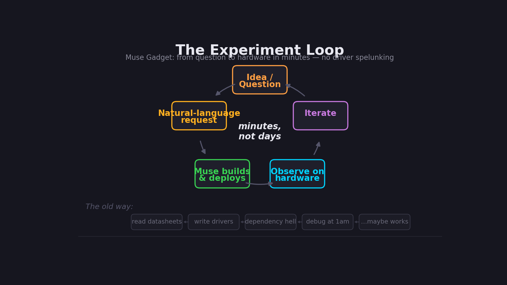

# The workflow

*The loop we ran seven times in one night, and how to run it yourself.*



## The loop

```
  ┌──────────────────────────────────────────────┐
  │                                              │
  ▼                                              │
┌───────┐    ┌──────────┐    ┌─────────┐    ┌────────────┐
│  IDEA │───▶│ SAY IT   │───▶│ IT RUNS │───▶│  OBSERVE   │
│       │    │ PLAINLY  │    │         │    │            │
└───────┘    └──────────┘    └─────────┘    └─────┬──────┘
       ▲                                        │
       │          ┌──────────┐                   │
       └──────────│ ITERATE  │◀──────────────────┘
                  │ or NEXT  │
                  └──────────┘
```

Five steps. The only unusual one is the second: you don't design the
implementation, you describe the *desired observation*. Everything else is
ordinary lab practice.

## 1. Idea — one question

Start with a question that fits in a sentence, preferably one that ends with
something you can *see*:

- "Can the LED matrix nag someone about the dishes?" → you see flashing, then a message.
- "Can the camera become a light meter?" → you see traces move.
- "Can the Pi see its own display?" → you see channels spike in turn.

If you can't picture the observation, the idea isn't ready. Sharpen it until
you can.

## 2. Say it plainly — the request

Talk to the agent the way you'd brief a competent lab partner. Real requests
from that night, verbatim in spirit:

| You say | What you mean |
|---|---|
| "make it flash" | attention-grabbing blink on the matrix |
| "Show me the fire simulator" | Doom-style fire, now |
| "Make a display that count 1-1000" / "One sec interval" | green numbers, 1 Hz |
| "if there is a new message, it flashes; once I click the button and read the message, clear the message and don't flash anymore" | flash-until-read state machine |
| "Do it. Fast." | skip the discussion, run it |

A good request has three properties: **one behavior**, **an observable
outcome**, and **no implementation details**. "Flashing white and blue until
the button is pressed" beats "write a Python loop with PWM". Let the agent
pick the mechanism; you judge the result.

## 3. It runs — what happens underneath

While you watch, the agent does the unglamorous part. A typical night
involved, per experiment:

- SSH from the workstation to Pi #1, then hop to Pi #2 (the gadget's
  network path)
- `pip install --break-system-packages` for `evdev`, `uflash`,
  `opencv-python-headless`, `flask`
- Writing the script, `scp` between machines, syntax-checking
- Process wrangling: `nohup`, log files, restarts — including the classic
  failure where `pkill -f` matched its own SSH command line and killed the
  session (recovered by killing via anchored patterns and PIDs)
- Driver-level debugging: the Sense HAT joystick produced *zero* events
  through the `sense_hat` stick API, so the agent dropped to raw `evdev`
  reads on `/dev/input/event4`

You don't need to know any of this to run the loop. But it's all real, and
the scripts in `src/` are the proof — read them when you're curious how
something actually worked.

## 4. Observe — eyes on the phenomenon

This is the step the old workflow starves. That night, observation was
always *live and physical*:

- The fire sim was judged by looking at the matrix, not by reading code.
- The RGB dashboard was validated by waving a hand over the lens and
  watching traces fall on a phone screen.
- The color feedback loop was confirmed the moment the red trace spiked.

Keep the observation loop under a minute whenever possible. If you can't see
the result quickly, shrink the experiment until you can.

## 5. Iterate or next — the beacon's three lives

The message beacon went through three versions in about fifteen minutes:

1. **v1** — gentle breathing rainbow, center-button press only. Verdict: too
   subtle, too picky about the button.
2. **v2** — hard white/blue blink, any joystick direction. Verdict: visible,
   but flashes forever, even with no message.
3. **v3** — flashes *only* when `~/led-message.txt` is non-empty; button
   press shows the message once, clears the file, display goes dark.
   Verdict: that's the product.

Each iteration was one sentence. Total human keystrokes for the whole arc:
under 200. That's the workflow compounding.

## Tips

- **Small steps, fast verdicts.** "Show me the fire simulator" beats a spec
  doc. You can steer a running demo; you can't steer a plan.
- **Describe the observation, not the code.** "Each channel should spike in
  turn" is a complete spec.
- **Keep the scripts.** They're in `src/` — tonight's throwaway demo is next
  month's starting point.
- **Write the notebook entry.** Question, build, observation, next question.
  Five minutes, in `experiments/`. Future you will thank present you.
- **It's fine to stop.** "Ok stop now" / "Ok stop the server now" are
  first-class workflow commands. Demos are disposable; the record isn't.

## From demo to durable

Nothing that night was built to last — and that's fine. When something
deserves to survive (the beacon did), the path is short: the script already
exists, the behavior is already validated, and the notebook entry is already
written. Durability is a separate decision, made *after* the experiment, not
before it.
